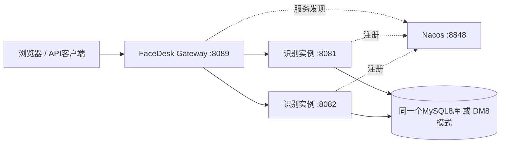

# FaceDesk 数据库与分布式部署

## 存储三选一

| 配置 | 数据库 | 多实例部署 |
| --- | --- | --- |
| 默认 / facedesk.storage.type=sqlite | SQLite，本地data/face.db | 单机，不连接Nacos |
| mysql profile | MySQL 8，共享库 | 可追加cluster profile |
| dm profile | 达梦 DM8，共享Schema | 可追加cluster profile |

每次启动只创建一种仓储，不双写其他数据库。切换存储不自动搬运原有SQLite人员或历史；先备份并制定原图/历史迁移方案。所有共享同一数据库的实例必须使用完全一致的模型文件和预处理配置。SQLite原有模型迁移流程只适用于SQLite；共享库模型升级需要统一停机并重建全部原图特征，禁止新旧模型混跑。

## 初始化空库

先执行 mvn package。凭据通过环境变量注入，以下交互输入不会写入项目配置：

```powershell
$env:FACEDESK_DB_USER = '初始化账户'
$env:FACEDESK_DB_PASSWORD = [System.Net.NetworkCredential]::new('', (Read-Host -AsSecureString '数据库密码')).Password
# MySQL：创建facedesk数据库并建表
$env:FACEDESK_DB_URL = 'jdbc:mysql://localhost:3306/'
./scripts/init-database.ps1 -Type mysql -Schema facedesk
# 达梦：创建FACEDESK模式并建表，账号需有创建Schema权限
$env:FACEDESK_DB_URL = 'jdbc:dm://localhost:5236'
./scripts/init-database.ps1 -Type dm -Schema FACEDESK
```

初始化工具从已构建JAR提取对应JDBC驱动，使用Java 11源文件模式运行。只在空数据库/Schema执行，存在表就拒绝覆盖。MySQL/DM的DDL不保证事务回滚；初始化中断后应检查结果，用新的空库重试。脚本中的Schema名称限制为字母、数字与下划线。也可通过数据库客户端手工执行对应的 db/mysql/schema.sql 或 db/dm/schema.sql（源码位于facedesk-api/src/main/resources/db/）。不要在每个实例启动时重复执行DDL；facedesk.storage.initialize-schema默认false，启用自动初始化只适用于单次空库初始化进程。

DM驱动默认 com.dameng:DmJdbcDriver18:8.1.3.62，实际部署应按达梦服务端匹配驱动版本，可通过Maven依赖版本调整后重建。MySQL驱动为Connector/J。驱动随JAR分发，许可信息见THIRD_PARTY_NOTICES.md。

## 单实例选择数据库

```powershell
# SQLite（默认）
java -jar facedesk-api/target/facedesk-api-1.0.0.jar
# MySQL，FACEDESK_DB_USER/PASSWORD由运行环境提供
$env:FACEDESK_DB_URL = 'jdbc:mysql://localhost:3306/facedesk?useUnicode=true&characterEncoding=UTF-8&serverTimezone=UTC'
java -jar facedesk-api/target/facedesk-api-1.0.0.jar --spring.profiles.active=mysql
# 达梦，模式名区分大小写；默认FACEDESK
$env:FACEDESK_DB_URL = 'jdbc:dm://localhost:5236'
$env:FACEDESK_DB_SCHEMA = 'FACEDESK'
java -jar facedesk-api/target/facedesk-api-1.0.0.jar --spring.profiles.active=dm
```

mysql和dm profile只选一个。也可直接配置facedesk.storage.type=mysql或dm，并完整提供spring.datasource.url/username/password/driver-class-name；DM另需设置spring.datasource.hikari.schema。数据库连接池属于单个进程；按实例总数配置数据库连接数。

## Nacos与网关

### SQLite 单机服务通过网关访问

无参数启动时，API 使用 SQLite，网关默认启用 `standalone` profile 并代理到8090，不依赖 Nacos。IDE中直接启动两个应用即可。旧版本默认使用Nacos，若返回503“暂无可用的FaceDesk识别实例”，请重新构建并重启网关，或显式启用 `standalone` profile：

```powershell
# API 已运行在8090时，重启网关并指定单机代理模式；IDE中同样设置 active profiles=standalone。
java -jar facedesk-gateway/target/facedesk-gateway-1.0.0.jar --spring.profiles.active=standalone --server.port=8089
# 后端端口不同时，启动网关前设置完整API源地址（不带/api，原请求路径会保留）。
$env:FACEDESK_API_URI = 'http://127.0.0.1:8090'
```

浏览器访问 `http://localhost:8089/api/`。此模式只代理一个 API，不启用 Nacos，也不提供多实例部署；不会自动切换数据库或搬运已有 SQLite 数据。

### MySQL / 达梦分布式模式

API 需启用 `mysql,cluster` 或 `dm,cluster` profile，网关显式启用 `cluster` profile。仅启用 `mysql` / `dm` 仍是单实例模式，不能作为网关集群服务发现路由的目标。API 与网关的 Nacos 地址、namespace、group 和服务名必须一致，且 API 实例元数据中应有 `facedesk-route-id`。启动网关不等于启动了两个识别实例。

Nacos控制台 http://localhost:8848/nacos，对应NACOS_SERVER_ADDR填写localhost:8848，不能包含http或/nacos路径。Nacos 2.x客户端还需要可访问服务端gRPC端口（默认9848）。多机器部署时填写服务器可达的Nacos地址，并确保注册的API实例IP和端口能从网关访问。



```powershell
$env:NACOS_SERVER_ADDR = 'localhost:8848'
$env:NACOS_GROUP = 'FACEDESK'
# 可选：NACOS_NAMESPACE / NACOS_USERNAME / NACOS_PASSWORD
# 各API实例使用相同数据库与模型目录，分别在独立终端/容器运行
java -jar facedesk-api/target/facedesk-api-1.0.0.jar --spring.profiles.active=mysql,cluster --server.port=8081
java -jar facedesk-api/target/facedesk-api-1.0.0.jar --spring.profiles.active=mysql,cluster --server.port=8082
# 使用达梦时把mysql替换为dm
mvn -pl facedesk-gateway -am package
java -jar facedesk-gateway/target/facedesk-gateway-1.0.0.jar --spring.profiles.active=cluster
```

访问 http://localhost:8089/api/ 。Gateway是独立可执行的Maven子模块，不包含OpenCV模型或数据库驱动。多网关实例可以连接相同Nacos，无需共享网关进程内任务状态。API注册名facedesk-api，网关注册名facedesk-gateway，namespace与group须一致。网关保留/api路径，上传视频流式转发，不重试录入/任务创建等写请求。后端启动可在外部application.yml覆盖模型路径、数据库与注册配置，数据库密码无需写进配置文件。

## 多实例一致性与任务边界

- 档案及参考照片存共享数据库，每次查询先核验revision；写事务通过元数据行锁序列化并递增revision，各节点在下次读取刷新完整快照。独立文件锁只用于SQLite。共享库不可用时不会静默回落到本地SQLite。
- 每个进程启动生成新的路由令牌，写入Nacos元数据和视频/实时会话ID。网关从Nacos查所属实例，任务归属优先于浏览器Cookie；节点离线返回503，不把旧会话交给另一节点。旧UUID任务ID不能跨单机/分布式模式恢复，应重新创建任务。
- 浏览器管理请求通过HttpOnly亲和Cookie落到同一可用节点；无Cookie的新客户端轮转分配。引擎状态、暂停/恢复/重载和任务容量是当前节点的状态，不是全集群控制；页面显示当前节点ID。任务ID含归属，因此不依赖该Cookie也能查询和停止已有任务。
- 视频原文件/临时结果、实时采集及USB画面仍由创建节点持有，不会在节点故障后自动续跑。档案和已落库历史保留。需要HA续跑时应另行引入共享对象存储和任务调度，不应把节点失联伪装成继续处理。
- 共享库节点心跳默认5秒、租约30秒。新实例启动不会中断健康节点；租约过期后将该节点的未完成历史标为INTERRUPTED。节点失去有效租约会拒绝新业务请求，历史写入也校验并锁定租约，防止过期进程把已中断任务写回完成。服务器时间需同步。停机、数据库不可用及服务发现同步存在窗口，客户端应根据503重新连接或提交任务。
- 所有实例需有各自可用的模型文件；RTSP节点还需安装FFmpeg。USB从浏览器所在电脑取流；远程浏览器需HTTPS授权摄像头。数据库并发不会替代推理算力，实例数量与CPU/内存配额需实测。

## 构建与离线分发

```powershell
mvn package
./scripts/package-offline.ps1 -IncludeGateway -Output ./target/facedesk-cluster-offline
```

离线包包含API JAR、模型、三种数据库配置、DDL、初始化工具，以及选择包含的Gateway JAR/配置/启动脚本。Nacos、MySQL和达梦服务器由部署环境提供；本地工作记录、连接凭据及生产数据库不会打包。仅API单机可省略-IncludeGateway。

## 验证

mvn test覆盖SQLite与H2的MySQL/Oracle兼容模式仓储契约测试；mvn -pl facedesk-gateway -am test覆盖归属路由、Cookie亲和性、无可用实例和连接失败。H2不代表真实MySQL/达梦验证。模型测试需本地模型和测试图片，使用-Dface.integration=true；性能与准确率按现场样本独立评估。

## MyBatis-Plus 数据访问

MySQL/达梦使用 MyBatis-Plus 3.5.7（Spring Boot 2 starter），连接池仍为 HikariCP。数据库选择和环境变量保持不变，不需要修改既有表或迁移数据。SQLite 保留原有 JDBC 文件仓储和模型迁移流程，仅支持单实例。

实体与 Mapper 位于 `facedesk-api/src/main/java/com/face/api/persistence`。档案采用 role/code 联合主键，更新和删除始终同时限定两列，不使用单列主键方法。参考照片、历史、节点及元数据使用各自的主键映射；识别历史分页由 MyBatis-Plus 的 MySQL/DM 方言插件生成。

元数据锁和节点租约锁使用 Mapper 中的显式 FOR UPDATE SQL。Mapper 与事务管理器共用同一 DataSource，档案写入、参考照片变更及 revision 递增共同提交或回滚。查询缓存已关闭，避免跨实例读取旧档案；Mapper 参数日志关闭，防止原图与特征通过 SQL 日志输出。历史筛选继续参数绑定并转义 LIKE 通配符，任务终态更新显式允许清空错误字段。
